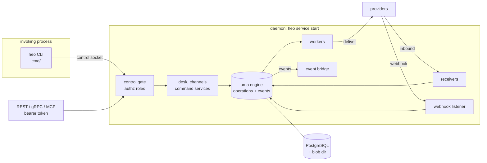

# Architecture: heo

heo is the command line and daemon in front of uma, the engine that keeps conversations,
messages, contacts and a delivery ledger for messaging providers. uma holds the state and the
rules; heo decides who may call it, reaches it from a terminal or a program, and runs the
loops that receive from and deliver to providers.

## Shape

The same diagram is `diagrams/architecture-v1.mmd`; edit both together.

One **daemon per profile** owns the profile's data store as its exclusive owner. Everything that
touches uma runs in it. The CLI is a thin client: a command that needs the runtime is sent over
the profile's control socket, authorized there, and its answer, error envelope and exit code are
rendered back in the caller's `--format`. A command that needs none (`adapter`, `config`, `spec`,
`storage`, `upgrade`) runs in the invoking process. Nothing starts a daemon for you.

## Packages

| Path | Does |
| --- | --- |
| `cmd/` | the command tree on kit's CLI root: every verb, its side-effect annotation, examples and next steps |
| `internal/control` | the socket client the CLI uses, and the rules every served surface applies |
| `internal/daemon` | the runtime services on kit's supervisor: workers, receivers, webhook listener, event bridge |
| `internal/desk` | what the conversation, message, note, contact, delivery and event verbs do over uma |
| `internal/channels` | channel and inbox plans, writes and checks |
| `internal/authz` | roles (operator, desk, viewer, external) as one policy for the gate and the runtime |
| `internal/adapters`, `internal/composition` | the uma adapters a binary runs and the HTTP client they share |
| `internal/credentials` | credential backends, one per profile; configuration holds references only |
| `internal/storage`, `internal/blobs` | the storage driver contract (PostgreSQL), backups, migration; attachment bytes |
| `internal/settings`, `internal/profile` | layered configuration with the origin of each value; profile references |
| `internal/errmap` | one map from failures to the error envelope, exit code and retry class |
| `internal/refdoc` | the generated command reference and cheatsheets |

## Data flow

**A write.** A verb such as `message reply` is authorized in the daemon, previewed with
`--dry-run` or submitted to uma as an operation under an idempotency key. uma accepts it durably
and the command returns `queued`; a worker leases the operation, checks the actor's permission
again, and the adapter delivers it. The delivery's state (`provider_accepted`, `delivered`,
`failed`, `outcome_unknown`, `dead_lettered`) is read back with `delivery get`; an unknown outcome
is settled with `delivery reconcile`, never resent blind.

**An inbound message.** A receiver (a mailbox, a polling loop, the MX listener) or the webhook
listener hands provider content to uma as the runtime's own actor, which can read channels and
stage media and do nothing else. uma files it into a conversation by the inbox's selection mode
and commits an event.

**Events.** The bridge tails uma's committed events as a durable subscription of its own and
republishes them, as references, on the daemon's in-process bus. `event list` and `event watch`
read the same events for a caller, each authorized again.

## Decisions that shape the code

- **uma owns state and rules; heo owns the front end.** heo calls uma's public service
  interfaces and keeps only what uma cannot hold: the profile's configuration,
  credentials, and the attachment directory.
- **No auto-start.** A daemon-backed verb with no daemon exits 70 with the fix. Predictable
  beats convenient for a tool that agents call.
- **Deny by default.** An actor holds the roles the configuration grants it. The actor comes
  from the transport (the socket peer's uid, or the verified token's subject), never from the
  request.
- **Every verb declares its side effect.** The tier drives confirmation, which surfaces serve
  the verb, the dry-run contract and the docs: `make spec` fails while a verb lacks one.
- **Generated reference.** Anything the code already knows is rendered into the docs by
  `make docs-gen` and checked in tests; see [DEVELOPING](DEVELOPING.md#generated-docs).
- **uma holds held operations and trust state; heo supplies policy.** An operation from a
  `plugin:` actor waits for a person before it applies. The wait is a held status in uma's
  operation ledger, before intent (proposer, preview, trust key, expiry, decided-by); trust
  counters are uma records. heo supplies the thresholds and always-held rules as
  configuration, and the verbs. Fixed rules: only `plugin:` actors can be held, never a
  person's own writes; approve applies with the original idempotency key; edit applies the
  edited args and counts as a correction; reject applies nothing and counts as a correction;
  visibility follows the target's read rights. Rejected: a heo-owned store (contradicts "uma
  owns state"; two places hold conversation state) and per-plugin queues (nothing generic;
  every plugin rebuilds approval and trust).
- **Loopback only.** REST, gRPC and MCP bind loopback and require a credential there too;
  serving beyond the machine is not supported in this release.

### Hook runner

Plugins react to events by returning operations. Each decision names the alternative it
rejected. The contract is in [manual](manual/deliveries-and-events.md#hook-plugins); the
wire shapes are [hook-envelope.schema.json](hook-envelope.schema.json) and
[hook-result.schema.json](hook-result.schema.json).

- **heo owns the runner.** It borrows the style of the cross-tool hook contract (a JSON
  envelope on stdin, JSON on stdout, exit codes) and nothing else. Rejected: delegating to
  that tool's runner. Its exit codes model a gate (allow, warn, block, rewrite) on an action
  about to happen; a heo plugin acts after a commit and returns operations, so the codes do
  not fit and a second daemon would sit between uma and the actor model.
- **A plugin is the actor `plugin:<name>`.** `svc:` stays reserved for the runtime and the
  bridge, and a grant naming one stays a configuration error. Rejected: running plugins as
  `svc:` actors or as the installation owner, which would let a plugin act with the
  runtime's or the owner's reach and make audit unable to tell them apart.
- **Isolation is authorization, not the OS.** A plugin runs as the daemon's OS user, so what
  confines it is what its actor may do through heo. Rejected: enforcing a uid, container or
  sandbox switch in heo. That is portable to no platform heo supports, and heo would own a
  boundary it cannot verify. Running a plugin under another uid or in a container is
  deployment guidance, documented, not enforced.
- **A plugin process is hardened by what heo hands it, not by the OS.** A scrubbed
  environment (`PATH`, its name, its own `plugin:<name>` token and the REST address),
  its own `0700` working directory, a stdout cap (over it is malformed output) and
  stderr routed to the daemon log under its name. A plugin with no token minted is not
  started. Rejected: inheriting the daemon's environment minus a denylist, which leaks
  whatever the denylist missed; and starting it tokenless, where every attempt fails
  and dead-letters. The manual lists what is and is not isolated.
- **Delivery is a durable uma subscription per plugin.** Each plugin reads the event log as
  its own named subscription beside `heo-bridge`, with its own checkpoint and its own
  actor, first read from the tail like the bridge. Delivery is at least once; an
  idempotency key on every operation makes application exactly once. The default key is
  the plugin, the event ID and a hash of the operation's content (verb, args, flags as
  canonical JSON); a plugin may override it with its own `idempotency_key`. Rejected: the
  in-process bus, which is best-effort, loses events for a slow or absent subscriber, and
  is not an outbox. Also rejected: an index-based default key, which changes meaning when a
  retry returns different operations, and required plugin-supplied keys, which make every
  plugin author get idempotency right before anything works.
- **A result is an ordered list of operations in the command vocabulary.** The runner
  applies them in order as the plugin's actor, stops at the first failure and leaves the
  earlier ones applied. Each is idempotent, so a retry re-sends the event and the applied
  prefix replays as no-ops. The failing index is recorded. Rejected: all-or-nothing, which
  uma's operations cannot provide across writes, and best-effort continue-after-failure,
  where later operations assume earlier ones.
- **An operation runs through the command tree's bridge as a verified REST caller.** The
  operation's `verb`, `args` and `flags` are what a REST request for the verb carries, so one
  code path serves the CLI, every served surface and the plugin, and the same gate and
  policy decide. Verbs a REST caller cannot run (terminal only, self-hosting such as
  `plugin token mint`, destructive) are refused, as are verbs acting on the daemon's machine
  and writes that cannot be replayed; a result naming one is rejected whole before anything
  runs. Replay rests on uma's operation key (the key is the verb's `--idempotency-key`), not
  on a ledger of heo's own. Rejected: a second, heo-side dispatcher, which would drift from
  the verbs' own checks, and a heo-side ledger of applied keys, which uma already keeps
  atomically with the write.
- **Two process modes.** Exec per event (a fresh process, one envelope, one result) is the
  default. A long-running subscriber, fed newline-delimited envelopes and answering with
  newline-delimited results, exists for interpreters whose start-up cost dominates.
  Rejected: subscriber-only, which makes the simple plugin pay for a protocol it does not
  need.
- **Exit codes are 0 ok, 1 retryable failure, 2 permanent failure, anything else
  retryable (a crash).** Rejected: nerv's gate codes, and fail-open on unknown codes. Unknown means
  the process died, and a lost event is worse than a repeated one under idempotent
  application.
- **Failures dead-letter and the stream moves on.** Exit 2, or exhausting a bounded retry
  policy (a maximum number of attempts with backoff; the defaults are set with the retry
  work), writes a dead-letter record that the CLI can retry, and the plugin's subscription
  advances. This mirrors delivery dead-lettering. Backoff is exponential with equal jitter
  (the wait is drawn from the upper half of the delay): full jitter can retry at once, none
  retries in lockstep. The attempt count is written to the store before each retry, so a
  restart continues it. uma's store has no record of a consumer's own and heo owns no
  tables, so records are files beside the plugins' directories, references only; replay
  reads the event again from uma as the plugin. Rejected: dropping the event on exit 2,
  which loses it silently; and quarantining or pausing the plugin, which lets one poison
  event stall every later event.
- **Operator verbs run in the daemon, and test never applies.** `hook list`, `hook test` and
  `hook dead-letter` read the runners and the store where they live (a daemon-backed verb over
  the control socket); `hook test` runs the plugin and reports its operations with the key and
  the check each would meet, never dispatching one. Rejected: a dry-run flag on a real run,
  which one slip turns into an application. A replay from a log position, `Runner.ReplayFrom`,
  is a bounded walk of uma's `Events.List` as the plugin's actor, not a move of the durable
  subscription: uma has no seek on one (a reopened consumer keeps its checkpoint). Rejected: a
  heo-side cursor beside uma's. A verb that applies a plugin's operations cannot run inside a
  command: the operations run through the command tree's bridge, whose tree lock the command
  already holds, so retry and replay queue an in-memory job that the daemon runs on its own
  goroutine and answer with its handle (`hook job get`). Rejected: running them in the
  command, which deadlocks, and a durable job table: dead letters are already durable.
